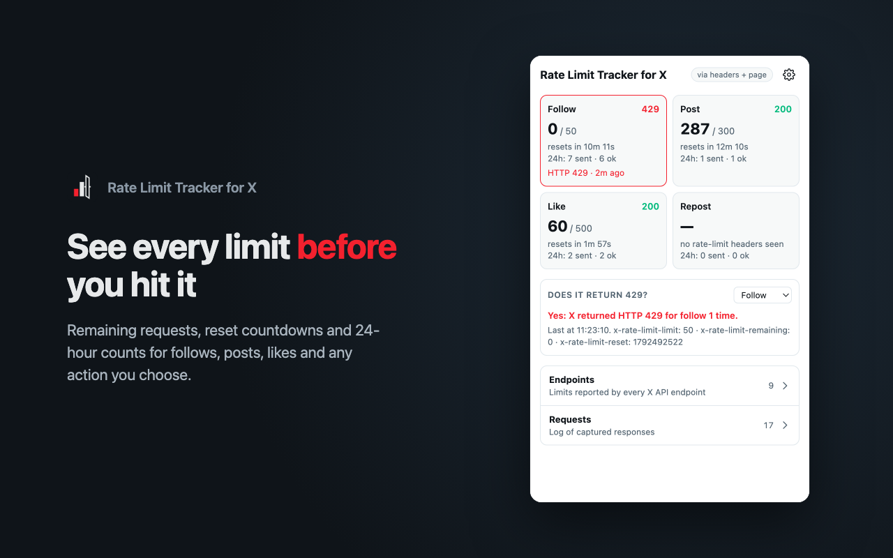
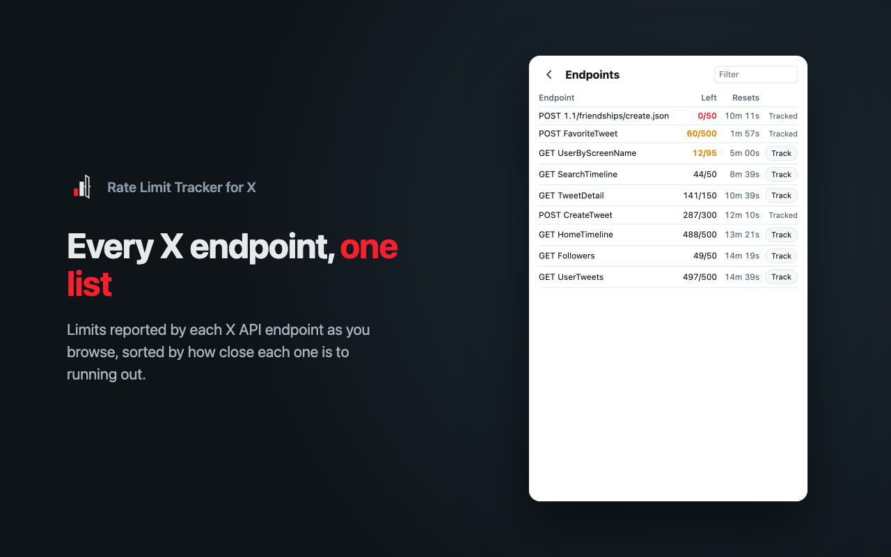
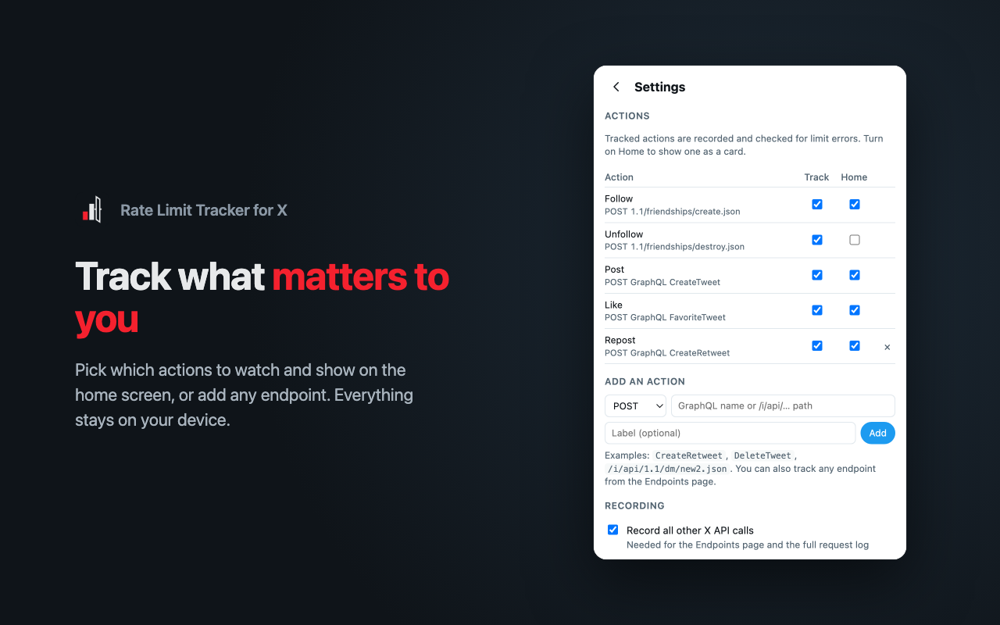

# Using the popup

The popup has four pages. Home opens first, and the others are one click away.

## Home

Each card is an action you've chosen to show on Home:

- **remaining / limit**, from X's `x-rate-limit-*` headers. A dash means X hasn't sent rate-limit headers for this action yet.
- **resets in…**, a countdown to when the current limit window ends.
- **24h**, how many of these actions you sent in the last 24 hours, and how many succeeded.
- The status code of the last response. The card turns red for a day after you hit a limit.

**Does it return 429?** says whether the selected action has hit a limit, and how X reported it. See [Rate limits on X](./limits).

## Endpoints

Every X API endpoint that has sent rate-limit headers, sorted by how close each one is to running out. Click **Track** on a row to turn that endpoint into a tracked action.

## Requests

A log of captured responses. Filter it to **All**, **Tracked actions** or **Errors only**. Hover a row to see the full path and whether it was captured from response headers, from the page, or both.

## Settings

- **Actions:** for each action, **Track** records it and checks it for limit errors, and **Home** shows it as a card. Remove an action you added with **×**.
- **Add an action:** enter a GraphQL operation name (like `CreateRetweet`), an `/i/api/…` path or a full URL, with an optional label.
- **Recording:**
  - **Record all other X API calls** fills the Endpoints page and the full request log. Turn it off to keep only tracked actions.
  - **Read X error codes from the page** catches limits X reports without a 429.
- **Data:** **Export JSON** saves your history to a file, and **Clear history** deletes it. Your settings are kept.

These actions are tracked out of the box:

| Action   | Request |
|----------|---------|
| Follow   | `POST /i/api/1.1/friendships/create.json` |
| Unfollow | `POST /i/api/1.1/friendships/destroy.json` |
| Post     | `POST /i/api/graphql/<id>/CreateTweet` |
| Like     | `POST /i/api/graphql/<id>/FavoriteTweet` |

GraphQL actions are matched by their operation name. The `<id>` part changes whenever X updates its website, so matching on it would break.
